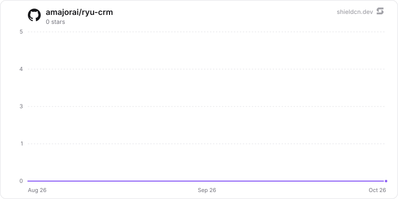

<div align="center">

# crm

</div>

An object-first CRM that starts as a data model rather than a fixed set of screens: define your own objects and typed fields, keep records as validated value bags with relation edges materialised both ways, work them through saved table/board/list views, and read one unified per-record timeline.

> **The public home of `ryu-crm`.** Source, builds, and releases live here —
> binaries for every platform are attached to each release.
>
> This tree is generated from the Ryu monorepo, so commits pushed here
> directly are replaced on the next sync. **Pull requests are welcome** —
> open them here and they are ported into the monorepo, then flow back out.
> Ryu as a whole: https://github.com/amajorai/ryu

## Install

**App:** [Install](ryu://apps/com.ryu.crm) (opens the Ryu desktop app and asks you to confirm)

**CLI:**

```bash
ryu apps add com.ryu.crm
```

**From source:**

```bash
cargo build --release --manifest-path backend/Cargo.toml
```

Prebuilt binaries for every platform are attached to [each release](https://github.com/amajorai/ryu/releases).

## License

Apache-2.0 — see [LICENSE](./LICENSE).

## The object model

| Table | What it holds |
| --- | --- |
| `objects` | Slug, singular/plural names, icon, title field. Five are seeded as standard; the rest are yours. |
| `fields` | Typed attributes per object — 17 types, from `text` and `currency` through `status`, `multi_select`, `rating` and `relation`. `config` carries select options, relation targets, currency codes. |
| `records` | A validated JSON value bag per row, keyed by field slug. Soft-deleted, so a delete is restorable. |
| `record_links` | Relation edges, materialised in **both** directions. |
| `views` | Saved table / board / list views: filter tree, sort list, visible field ids and order, board group-by. |
| `lists` + `list_entries` | Attio-style curated subsets with **list-specific fields** — a deal's stage inside one sales list, separate from the object's own status field. |
| `activities` | The unified timeline: notes, calls, meetings, tasks, plus the `field_change` / `stage_change` entries the store writes itself. |
| `import_jobs` | A CSV import with its column mapping, dedupe key, dry-run preview and result. |

A few decisions worth knowing:

- **Money is integer cents everywhere.** It divides exactly once, at the render
  edge, through `Intl.NumberFormat` with the field's currency — so a JPY amount
  gets no minor unit rather than being rendered a hundred times too small.
- **Relations are bidirectional edges, not a foreign key.** That is why a company
  page can show its people, its open deals, and every note written against any of
  them without anyone modelling the reverse side.
- **Audit entries are written by the store, not by a caller.** No route accepts a
  `field_change`. They are read back through the timeline and nothing else.
- **Changing a `select` field's options never orphans a value.** The store either
  migrates the existing values or rejects the edit with a reason.

## CSV import

First-class in v1, because an empty CRM is unusable and this is the step everyone
defers:

1. `POST /imports?object=<slug>` with the raw CSV. The bytes are persisted **with
   the job**, so preview and apply are two requests over the same file rather than
   two uploads.
2. The job comes back with inferred columns, sampled values, and a guessed field
   per column — a tidy file needs no mapping work, only confirmation.
3. `PUT /imports/:id/mapping` sets the column→field mapping (including "do not
   import") and the dedupe key.
4. `POST /imports/:id/preview` is a **dry run**. Nothing is written. It reports
   exact create / update / skip / error counts for the whole file, plus per-row
   conflicts and the columns nobody mapped.
5. `POST /imports/:id/apply` writes. Idempotent per job — applying twice does not
   double-create.

Duplicate detection and field-by-field merge reparent activities, list memberships
and relation edges onto the survivor before soft-deleting the loser.

## Surfaces

**Desktop** — a native dock panel (`contributes.dock_panels`), registered in
`NATIVE_DOCK_PANELS` in `apps/desktop/src/components/panels/WorkspacePanels.tsx`.
It fetches this sidecar over the generic ext-proxy. That is deliberate: a
CSP-sandboxed companion would have needed per-app bridge rows in `rpc.ts` and
`kernel-contracts` (the per-app Core coupling `AGENTS.md` forbids) and could not
have imported `@ryu/ui`, which for a CRM means hand-rolling the data grid.

**Agents** — eight tools declared as manifest `runnables` of `kind: "tool"` over
the same proxy (`crm.search`, `find_record`, `get_record`, `create_record`,
`update_record`, `log_activity`, `create_task`, `pipeline`). No MCP server and no
turn hook: the plugin sandbox has no HTTP, so a hook could not reach this sidecar
at all.

**Workflows** — four `contributes.hook_events`. `deal.stage_changed` fires only on
a real transition and carries both the old and new stage, so a rule can gate on a
direction; `task.due` is claimed with a compare-and-set, so two Harbor processes
against one data dir still announce a task exactly once.

## Running it standalone

```sh
cargo run -p ryu-crm
```

Listens on `127.0.0.1:8009` (`RYU_CRM_PORT` overrides; Core injects it
profile-shifted so dev and release nodes do not collide). The database is
`crm.db` in the app's plugin data dir (`RYU_PLUGIN_DATA_DIR`, `<data dir>/plugin-data/@ryu+crm`).

Every route under `/api/crm/*` requires the shared-secret bearer Core injects as
`RYU_EXT_TOKEN`, and the gate is **fail-closed** — with no token configured, a bare
run rejects every request rather than serving a node's contact database
unauthenticated. `/health` is the one un-gated route, because Core must probe it
before it has any reason to trust the process.

```sh
cargo test -p ryu-crm
```

## What the panel does not surface yet

The sidecar is complete; two of its surfaces have no UI in this version and are
reachable over the API only:

- **Curated lists** (`/lists/*`). The tables and routes exist, including
  list-specific fields, but the panel's rail does not render them yet.
- **Per-field merge resolution** (`MergePlan.resolutions`). The duplicates view
  shows the differing fields side by side and lets you pick which record survives,
  but the merge itself keeps the survivor's values wholesale; choosing a winner
  field by field is an API call.
- **View management** (`/objects/:object/views`, `/views/:id`). Saved views are
  read, switched between and run by the panel, and the seeded defaults cover the
  common cases — but creating, renaming, reordering or deleting one is an API call.

Everything else in this README is wired end to end: the schema editor, the grid,
the board, the record timeline, relation linking, CSV import and export, duplicate
detection and merge, the task inbox and the pipeline report.

## Deliberately out of scope for v1

Email sync, calendar sync, and Composio enrichment. Each is a different product
axis from "own your pipeline data", and each pulls in a credential story and a
polling loop that the scheduling half of the app does not need. The same call
`@ryu/social` made, for the same reason.

## At rest

`crm.db` seals record titles and value bags, activity titles, bodies, change values
(`from_value`/`to_value`) and metadata, list-entry value bags, and import jobs' file name,
columns, preview, result, error and uploaded CSV per value (`encb:v1:`, store `crm.db`, AAD
`(<table>.<column>, id)`) under the `@ryu/crm` plugin subkey Core delivers to the sidecar
(`crypto:seal` in `sidecars[0].host_api.grants`). The connection registers SQL functions bound
to that key: reads select `crm_open(purpose, id, stored)` (NULL when a value does not open;
counted in `/health` `sealing.unreadable_values`) and writes bind `crm_seal(...)`. Every
filter, sort, `json_extract`/`json_each` predicate, `SUM` aggregate, duplicate scan, import
match and uniqueness check therefore runs unchanged over the opened values (the same operators,
ordering and results by construction; `sealed_queries_match_the_plaintext_behaviour` checks
it against a plaintext store), and a per-connection plaintext cache keyed by `(purpose, id)` and
validated against the stored ciphertext keeps repeated scans cheap. Because queries sort and
group opened values, the connection sets `PRAGMA temp_store = MEMORY`, so a large sort never
spills plaintext to a temp file. Lists and search-index rebuilds skip a row that does not
open; a get of one fails. Uniqueness stays the in-transaction scan under the single-writer
mutex (no blind token needed, so nothing about duplicates leaks).

Plaintext on purpose: ids, object/field/view/list definitions (schema, not records), record
links, positions, `deleted_at`, timestamps, activity kind, assignee/author user ids and due
dates (the task sweep and filters query them), import mappings and dedupe rules.

Search: the plaintext `records_fts` index is replaced by `records_terms`, an FTS5
`detail = none` table of blind tokens: an HMAC (`crm.db`/`terms`) of each distinct word of the
title and searchable fields. Search matches whole words only (the word being typed matches once
it is complete); there is no prefix, phrase or `NEAR` search; one-letter words and stopwords are
not indexed. No prefix tokens are stored: nested prefix tokens of one word always co-occur, so
someone holding only `crm.db` could rebuild words from them. An index built by an earlier
build that also held prefix tokens is dropped (under `secure_delete`) and rebuilt at the next
open, followed by the freed-page scrub. Snippets are cut from the decrypted fields. The tokens
reveal which records share a word and how common each word is. In compat mode the index holds
the plain words and the last word typed still matches as a prefix, as before sealing.

Migration on open (synchronous: a second connection would break the single-writer rule the
uniqueness check relies on): `migrate_columns` seals legacy values (resumable, idempotent,
compare-and-swap), the term index is dropped and rebuilt whenever the key that built it
changes (the old plaintext FTS shadow tables go with schema v2), then freed pages are scrubbed
(`secure_delete = ON`, WAL truncate, freelist scrub, `VACUUM` when it fits). An applied
import's CSV is deleted. Key states (`src/seal_keys.rs`): compat mode under an older Core
(plaintext values and a plain-word index, `sealing.state = "compat"`, "waiting for a Ryu
update"); a store sealed under another key, or sealed data with no key, opens with writes
refused (`unhealthy`); standalone runs use `RYU_MASTER_KEY` or a generated, pinned
`<plugin data dir>/secrets/standalone-root.key`. The standalone satellite mirror builds
`ryu-crypto` from crates.io at the declared version, so the release train that ships this must
publish `ryu-crypto` first (already ordered before app backends in `tools/publish-crates.sh`).

## Star History

<a href="https://github.com/amajorai/ryu-crm/stargazers">
  <picture>
    <source media="(prefers-color-scheme: dark)" srcset="./.github/shieldcn/star-chart-dark.svg" />
    
  </picture>
</a>
